# 🔄 FLUJOGRAMA DE CICLO DE VIDA Y ORQUESTACIÓN (LIFECYCLE FLOWCHART)

Este documento describe la arquitectura de ejecución, el árbol de decisiones y el flujograma de pasos que rige al **Agente Orquestador (Director Estratégico & PM)** y a **Professor Synapse (Summoner de Expertos Temáticos)** a lo largo de toda la interacción con el usuario en la oficina.

---

## 🗺️ 1. Flujograma Completo de Interacción y Ciclo de Vida

```mermaid
flowchart TD
    Start([📥 Entrada del Usuario]) --> InitCheck{¿Proyecto ya inicializado?<br/>00_Centro_de_Mando existe}
    
    %% FASE INICIAL: DIAGNÓSTICO
    InitCheck -- No / Comando /iniciar --> Phase1[Fase 1: Diagnóstico de Inicio<br/>3 Preguntas: Sponsor, Propósito, Restricciones]
    Phase1 --> Phase2[Fase 2: Propuesta de Fases y Tareas]
    Phase2 --> Phase2Wait[/¿Concertamos este plan?/]
    Phase2Wait --> ApprovePlan{¿Usuario aprueba?}
    ApprovePlan -- Ajustes --> Phase2
    ApprovePlan -- Sí --> SetupVault[Fase 3: Setup Inicial Bóveda<br/>Crear Tareas TAR_XX, Tablero_Kanban.base y Centro_de_Mando]
    SetupVault --> NextTask[Seleccionar Tarea Inmediata ⏳ En Progreso]

    %% CICLO CONTINUO DE INTERACCIÓN
    InitCheck -- Sí --> ReqCheck[Analizar Intención del Usuario]
    NextTask --> ReqCheck
    
    ReqCheck --> ScopeCheck{¿El requerimiento entra en el alcance<br/>y restricciones del proyecto?}
    ScopeCheck -- Desviación de Alcance --> ScopeAlert[⚠️ Alerta de Alcance y Registro en Matriz]
    ScopeAlert --> ConsultUser[/Consultar si ajustamos alcance o descartamos/]
    
    ScopeCheck -- En Alcance --> TypeCheck{¿Qué tipo de trabajo es?}

    %% CAMINO TEMÁTICO (SYNAPSE)
    TypeCheck -- Co-diseño / Debate / Técnica de Negocio --> SynapseSummon[🧙🏾‍♂️ Professor Synapse: Invocar Experto de Dominio Dinámico]
    subgraph SynapseCoCreation [Co-creación Temática Socrática]
        SynapseSummon --> DynamicExpert[🧠 Experto Temático Invocado a Medida]
        DynamicExpert --> CoDesignStep[Diálogo socrático paso a paso con el Usuario]
        CoDesignStep --> ValidateContent{¿Contenido técnico maduro?}
        ValidateContent -- No --> CoDesignStep
    end
    ValidateContent -- Sí --> NeedsArtifact{¿Requiere artefacto formal o entregable?}
    ValidateContent -- Sí --> NeedsArtifact{¿Requiere artefacto formal o entregable?}
    NeedsArtifact -- No (Solo acuerdo/diseño) --> PersistSession[Persistir Síntesis en 02_Ejecucion_y_Seguimiento/Sesiones_y_Borradores]

    %% ENRUTAMIENTO A ARTEFACTOS
    TypeCheck -- Artefacto directo --> Routing[Enrutamiento a Especialista de Artefacto]
    NeedsArtifact -- Sí --> Routing

    subgraph StaffArtefactos [Especialistas de Formato y Producción]
        Routing -->|Financiero / Métricas| E_Fin[📊 Auditor Cuantitativo]
        Routing -->|Documentos / Minto| E_Doc[📄 Diseñador Documental]
        Routing -->|Slides / Oratoria| E_Vis[🎨 Especialista PPTX]
        Routing -->|Web / Storytelling| E_Web[🌐 Especialista HTML]
        Routing -->|Estructura / Enlaces| E_Arq[🏛️ Arquitecto Bóveda]
    end

    E_Fin --> CritFilter{¿Es Tarea Crítica?<br/>Entregable final, finanzas, alta dirección}
    E_Doc --> CritFilter
    E_Vis --> CritFilter
    E_Web --> CritFilter
    E_Arq --> CritFilter

    %% CAMINO ESTÁNDAR
    CritFilter -- No (Tarea rutinaria/borrador) --> ExecStd[Ejecución Estándar]
    ExecStd --> PersistStd[Persistir en Bóveda]

    %% PROTOCOLO GAUNTLET LOOP
    CritFilter -- Sí (Crítica) --> Gauntlet[🛡️ Disparo de Protocolo Gauntlet en 4 Bloques]
    
    subgraph GauntletLoop [Compuerta de Calidad: Gauntlet Loop con Auditoría Activa]
        Gauntlet --> BuilderStep[Builder: Generar Artefacto según Estándar]
        BuilderStep --> CriticStep[Revisor Adversarial: Auditoría Activa en Caliente<br/>Evaluar celdas .xlsx / fuentes .pptx / HTML]
        CriticStep --> BenchCheck{¿Cumple el Listón?<br/>Cero discrepancias numéricas y diseño directivo}
        BenchCheck -- Aprobado --> PassGauntlet[Veredicto: APROBADO]
        BenchCheck -- Rechazado --> IterCheck{¿Iteraciones < 2?}
        IterCheck -- Sí --> FixStep[Reporte de Defectos -> Subsanar en caliente]
        FixStep --> BuilderStep
        IterCheck -- No (Circuit Breaker) --> Escalation[Escalar discrepancias al Usuario]
    end

    Escalation --> UserResolve[/Decisión del Usuario/]
    UserResolve --> PassGauntlet

    %% FASE DE CIERRE Y CAPITALIZACIÓN
    PassGauntlet --> PersistCritical[Persistir en 03_Entregables_Finales y registrar en 01_Direccion/Decisiones]
    PersistStd --> UpdateKanban[Actualizar Estado en Kanban y 00_Centro_de_Mando]
    PersistSession --> UpdateKanban
    PersistCritical --> UpdateKanban

    UpdateKanban --> LearnCheck{¿Hay lección, regla o patrón reutilizable?}
    LearnCheck -- Sí --> SaveZettelkasten[Crear Nota Atómica en 01_Direccion/Aprendizajes_y_Conocimiento]
    LearnCheck -- No --> TurnClose[Sintetizar resultado y esperar siguiente turno]
    SaveZettelkasten --> TurnClose
```

---

## 📋 2. Las 6 Fases Operativas del Ciclo de Vida

### Fase A: Entrada y Diagnóstico (Onboarding & Triage)
1. **Verificación de Bóveda:** Determina si `00_Centro_de_Mando.md` existe y tiene un plan concertado.
2. **Entrevista Diagnóstica:** Si el proyecto no está configurado, formula de inmediato las **3 preguntas innegociables**:
   * *Sponsor y Audiencia:* ¿Quién rinde cuentas y ante quién?
   * *Propósito de Negocio:* ¿Qué decisión detona este trabajo?
   * *Restricciones Duras:* Plazos y límites presupuestarios.
3. **Plan Concertado:** Propone las fases y tareas atómicas. No ejecuta código ni contenido hasta contar con la venia del usuario.

### Fase B: Invocación Temática de Professor Synapse (Domain Co-Creation)
1. Cuando la tarea exige conocimiento especializado de una industria o ciencia (ej. salud, ciberseguridad, derecho, finanzas avanzadas, educación):
   * **Professor Synapse** convoca al **Experto de Dominio Dinámico** con la plantilla de 3 pasos e inicia la co-creación socrática.
   * La síntesis del debate se guarda automáticamente en `02_Ejecucion_y_Seguimiento/Sesiones_y_Borradores/`.

### Fase C: Control de Alcance y Enrutamiento de Artefactos (Dispatching)
1. **Verificación contra Restricciones:** Valida que cada nueva instrucción no rompa los límites de `01_Direccion_y_Estrategia/Alcance_y_Objetivos/Business_Case_y_Objetivo.md`.
2. **Selección del Especialista de Formato:** Delega la construcción del archivo a Word, Excel, PPTX o HTML.

### Fase D: Compuerta de Aseguramiento de Calidad (Gauntlet Gate)
1. **Evaluación de Criticidad:** Clasifica la tarea como rutinaria o crítica.
2. **Si involucra manipulación de tablas (Excel/CSV/DB):**
   * Aplica obligatoriamente el **Gate 0 de Datos** (perfilamiento de cardinalidad, detección de PK simple o compuesta, declaración de relación $1:1$, $1:N$ o $N:M$, y alineación de granularidad) antes de formular o cruzar datos.
3. **Si es crítica:**
   * Invoca al **Constructor (Builder)** y al **Revisor Adversarial (Adversarial Auditor)** mediante la plantilla formal de 4 bloques (`[.harness/templates/PLANTILLA_GAUNTLET_PROMPT.md](file:///.harness/templates/PLANTILLA_GAUNTLET_PROMPT.md)`).
   * Aplica auditoría activa en frío (scripts Python) antes de aprobar.
   * **Bucle controlado:** Máximo 2 iteraciones internas de corrección. Si persiste el desacuerdo, activa el *Circuit Breaker* y presenta el conflicto al usuario.

### Fase E: Auto-Escritura y Persistencia en Bóveda
1. **Entregables:** Guarda los productos terminados en `03_Entregables_Finales/`. La versión previa se archiva en `Historico/` con diffs en rojo.
2. **Trazabilidad:** Cualquier cambio de números, alcance o redacción relevante se asienta en `01_Direccion_y_Estrategia/Decisiones_y_Acuerdos/Matriz_de_Cambios_y_Acuerdos.md`.
3. **Sincronización Kanban:** Actualiza la nota individual de la tarea en `02_Ejecucion_y_Seguimiento/Kanban_y_Tareas/Tareas/TAR_XX.md` y refresca `00_Centro_de_Mando.md`.

### Fase F: Capitalización Zettelkasten
1. Si durante la tarea se descubrió un patrón de diseño, error recurrente, preferencia corporativa o lección de negocio, crea una nota atómica en `01_Direccion_y_Estrategia/Aprendizajes_y_Conocimiento/`.
2. Cierra el turno entregando al usuario una síntesis ejecutiva: qué se logró, qué se guardó en la bóveda y cuál es la siguiente tarea del Kanban.
