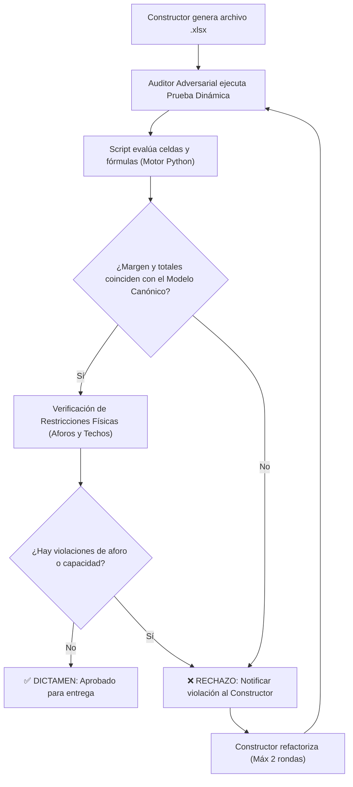

# 🚀 Propuesta Integral de Mejora del Arnés de IA
## Auditoría de Brechas Operativas y Especificación de Blindaje para Constructores (*Builders*) y Revisores Adversariales (*Harsh Critics*)

> **Contexto:** Documento de retroalimentación técnica elaborado tras la ejecución del caso de estudio de asignación docente y optimización financiera. Consolida las causas raíz de las fallas detectadas, las directrices de diseño para documentos ejecutivos (Word, PowerPoint, HTML y Excel) y los nuevos protocolos de auditoría que deben incorporarse al código y reglas del arnés.

---

## 📌 PARTE 1. Diagnóstico de Brechas Detectadas en la Sesión

Durante la interacción se evidenciaron cuatro brechas operativas en el ciclo del arnés:

1. **Falla en el Quality Gate de Hojas de Cálculo (`.xlsx`):**
   * *Síntoma:* El Excel entregado calculaba un Margen Neto de $ 284.7M en lugar del benchmark auditado de $ 280.2M (diferencia de $ 4.5M).
   * *Causa Raíz:* El Constructor agrupó 40 alumnos en una sola celda ignorando el aforo físico ($U_i = 22$) y sesgando la fórmula `=COUNTIF`, que contó 10 secciones en lugar de 11.
   * *Falla del Revisor Adversarial:* El Crítico validó la presencia de fórmulas y la sintaxis, pero **no ejecutó una prueba de corrida dinámica en frío (evaluación de celdas con motor de cálculo)** antes de dar el visto bueno al usuario humano.
2. **Desincronización Iterativa de Informes ante Nuevos Escenarios del Usuario (Brecha Crítica de Continuidad):**
   * *Síntoma:* Cuando el usuario planteó un nuevo escenario de sensibilidad (ingreso del nuevo docente con perfil específico en Álgebra Lineal y Analítica Prescriptiva), el informe ejecutivo principal (`Informe_Gerencial_Oferta_Academica.md` y `.docx`) no se actualizó automáticamente de inmediato, sino que se crearon análisis satélite aislados.
   * *Causa Raíz:* El arnés carece de una regla explícita que obligue al agente a **mantener el informe ejecutivo vivo (Living Document Pattern)**, absorbiendo cada ajuste o decisión de escenario solicitada por el usuario en el entregable principal.
3. **Falta de Estándares Tipográficos y de Contenedor en Diapositivas (`.pptx`):**
   * *Síntoma:* La primera versión de PPTX utilizaba cuadros de texto flotantes con riesgo de superposición y fuentes inferiores a 12pt, ilegibles para un comité de decisión en proyector o pantalla compartida.
   * *Mejora Exigida:* Se debió imponer un piso mínimo de **22pts** y empaquetar textos dentro de las formas geométricas nativas.
4. **Ausencia de un Estándar para Presentaciones Web Nativas (`.html`):**
   * El arnés no contaba con una plantilla predefinida de *Deck Web* en tema claro (16:9, responsive, navegación por teclado), obligando a improvisar el diseño interactivo.
5. **Desarticulación entre Formato Editable y Formato de Lectura en Word (`.docx` vs `.md`):**
   * La generación de documentos de texto para la dirección no sincronizaba de forma inmediata la versión ejecutable en Word con la nota nativa de Obsidian en Markdown.

---

## 🛠️ PARTE 2. Estándares Técnicos Obligatorios para Constructores (*Builders*)

Para que el arnés genere productos de nivel directivo desde el primer intento, se deben formalizar estas especificaciones en `.harness/REGLAS_OPERATIVAS_IA.md` y en los prompts de los agentes especialistas:

### 2.1 Especificación para Presentaciones en PowerPoint (`.pptx`)

1. **Piso Tipográfico de 22 Puntos (Regla de Sala de Juntas):**
   * **Cuerpo de texto, celdas y viñetas:** Mínimo absoluto de **`22pt`**.
   * **Subtítulos y encabezados de tarjeta/tabla:** **`24pt` a `26pt`**.
   * **Títulos de diapositiva:** **`28pt` a `32pt` Bold**.
   * **Cifras de KPIs principales:** **`44pt` a `48pt` Bold**.
   * *Consecuencia directa:* Una diapositiva no puede sobrecargarse de texto; si un contenido excede el espacio a 22pt, el Constructor **debe paginar en 2 láminas** (Parte 1 y Parte 2).
2. **Textos Nativos en Contenedores (Cero Cajas Flotantes Desalineadas):**
   * Prohibido crear un rectángulo decorativo y encima un `textbox` flotante sin anclar.
   * El texto debe escribirse directamente en el `text_frame` de la forma (`shape.text_frame`) configurando `margin_top`, `margin_bottom`, `margin_left` y `margin_right` explícitos.
3. **Paleta de Tema Claro Corporativo:**
   * Fondo general: Gris perla suave (`#F1F5F9`).
   * Contenedores/Tarjetas: Blanco puro (`#FFFFFF`) con bordes sutiles (`#CBD5E1` o `#E2E8F0`, 1.5pt a 2pt).
   * Textos: Carbón oscuro (`#0F172A`) y pizarra (`#475569`). Títulos en Azul Marino (`#102C57` o `#1E3A8A`).

### 2.2 Especificación para Presentaciones Web Interactivas (`.html`)

1. **Estructura Viewport 16:9 Fija:**
   * El contenedor central debe tener proporciones de proyección estándar (ej. `1280px × 720px` o escala responsiva manteniendo relación 16:9).
2. **Navegación Dinámica Nativa:**
   * Soporte obligatorio para teclas de flecha (◀, ▶), barra espaciadora (`Space`) y botones visuales de Anterior/Siguiente.
   * Barra inferior persistente con indicador visual de avance (dots interactivos) y contador de diapositivas (`N / Total`).
3. **Tipografía y Estilo Limpio:**
   * Usar fuentes modernas web seguras o Google Fonts de primer nivel (`Plus Jakarta Sans` o `Inter` para títulos/cuerpo, y `JetBrains Mono` para cifras/tablas).
   * Regla `@media print` embebida para que el usuario pueda exportar la presentación directamente a PDF con `Ctrl + P` sin romper el diseño.

### 2.3 Especificación para Documentos de Texto (`.docx` y `.md`)

1. **Simetría Bimodal Obrigada:**
   * Cada vez que se genere un informe en Word (`05_Entregables/Nombre.docx`), el agente **debe generar simultáneamente la réplica exacta en Markdown (`05_Entregables/Nombre.md`)** para su lectura y visualización directa dentro de la bóveda de Obsidian.
2. **Enfoque de Negocio Minto:**
   * Estructura ejecutiva: (1) Resumen Ejecutivo con cifras clave, (2) Análisis Financiero, (3) Plan Operativo y (4) Decisiones y Recomendaciones Directivas. Cero tecnicismos innecesarios en documentos destinados a comités.
3. **Patrón de Documento Vivo con Versionamiento Histórico y Marcado de Cambios (Diff Markup):**
   * **REGLA DE CONTINUIDAD ITERATIVA Y NO DESTRUCCIÓN DEL HISTÓRICO:** Cuando el usuario introduzca un cambio de escenario, nueva sensibilidad o ajuste de parámetros, el agente **NO debe sobrescribir ciegamente los documentos anteriores**. Debe preservar el histórico para garantizar trazabilidad directiva total.
   * **A. Estándar de Nomenclatura e Indicadores de Estado:**
     * **Versión Vigente / Final:** Se conserva en la raíz de `05_Entregables/` con la marca clara de versión e iteración en el nombre y frontmatter:
       * Ej: `Informe_Gerencial_Oferta_Academica_v2.0_FINAL_2026-10-12.docx` (y su réplica `.md`).
       * **Badge Visual Superior:** Encabezado con distintivo en verde: `🟢 VERSIÓN VIGENTE / APROBADA - Iteración 2.0 (Fecha: YYYY-MM-DD HH:MM)`.
     * **Versiones Anteriores (Histórico Conservado):** Se trasladan o renombran explícitamente a:
       * `05_Entregables/Historico/Informe_Gerencial_Oferta_Academica_v1.0_OBSOLETO_2026-10-12.docx` (y `.md`).
       * **Marca de Agua / Banner Superior:** `🔴 VERSIÓN SUPERADA / NO VIGENTE - Iteración 1.0 (Para trazabilidad histórica)`.
   * **B. Marcado Explícito de Cambios en Rojo (Visual Diff & Red Annotations):**
     * En los documentos anteriores (o en informes de control de cambios), las secciones, tablas, cifras o párrafos que fueron alterados o superados por la nueva decisión deben estar **resaltados o anotados en color rojo** (en Word mediante formato de fuente roja / tachado, y en Markdown mediante HTML `<span style="color:#DC2626;">...</span>` o llamadas de alerta tipo `[!WARNING]`).
     * **Anotación Marginal Obligatoria:** Cada fragmento modificado debe incluir una breve llamada explicativa en rojo:
       * Ej: `[🔴 MODIFICADO EN v2.0: Cifra de margen base de $246.4M superada por $280.2M tras contratar docente D05 en Analítica]`.
   * **C. Cuadro de Control de Versiones en el Documento Final:**
     * Todo informe final vigente debe contener obligatoriamente una **Tabla de Historial de Iteraciones** al inicio:
       * `Iteración | Fecha | Autor/Solicitante | Qué Cambió | Justificación de Negocio | Enlace a Versión Anterior (Con Marcas Rojas)`.
     * Esto permite a cualquier miembro del comité entender con total claridad de dónde venía el documento, qué se modificó y por qué la versión en sus manos es la definitiva.

### 2.4 Especificación para Hojas de Cálculo y Modelos Financieros (`.xlsx`)

1. **Regla de Correspondencia Unívoca Celda-Variable:**
   * En matrices de asignación ($i \times k$), una celda representa **una única sección o evento operativo**. Si un recurso asume 2 secciones de una misma materia, la matriz debe tener filas separadas (ej. `C03 - Sec 1` y `C03 - Sec 2`) o columnas que impidan violar las restricciones de aforo ($x_{ik} \le U_i$).
2. **Formulación Dinámica Estricta:**
   * Las celdas de ingresos, costos, márgenes y conteo deben operar mediante fórmulas de Excel (`SUM`, `COUNTIF`, multiplicadores por tarifa), nunca con valores fijos "quemados" en el código.
3. **Zona Editable vs. Zona Calculada:**
   * Colorear visualmente las celdas de entrada del usuario (ej. fondo azul tenue `#EFF6FF`) y bloquear/destacar las celdas formuladas de cálculo automático.

---

## 🛡️ PARTE 3. Rediseño del Revisor Adversarial (*Harsh Critic Protocol 2.0*)

El cambio más crítico que debe integrarse en el arnés es **la transformación del revisor adversarial de un evaluador superficial a un auditor de ejecución activa**.

### 3.1 El Nuevo Protocolo de Validación en Caliente (Pipeline Obligatorio)

Cuando una tarea involucre un modelo cuantitativo o archivo de datos (`.xlsx`, `.csv`), el Revisor Adversarial **tiene prohibido aprobar la tarea basándose en la lectura del código o en el reporte de texto**. Debe ejecutar obligatoriamente el siguiente pipeline:



### 3.2 Listón Observable Auditado por Tipo de Artefacto

El Revisor Adversarial debe cotejar contra esta lista de control binaria (Pasa / No Pasa):

| Artefacto | Verificación Obligatoria del Revisor Adversarial | Criterio de Rechazo Inmediato |
|---|---|---|
| **Excel (`.xlsx`)** | **Evaluación Numérica de Fórmulas:** Ejecutar script que lea los valores calculados de las celdas finales de KPI y los compare contra el modelo canónico. | Diferencia $\ne 0$ entre el margen del Excel y el modelo matemático; celdas que violen aforos ($x_{ik} > U_i$). |
| **PowerPoint (`.pptx`)** | **Auditoría de Tamaño y Anclaje:** Recorrer las formas del archivo verificando que ningún párrafo de texto tenga `size < 22pt` y que no existan cuadros de texto flotantes huérfanos. | Cualquier texto $< 22\text{pt}$; cuadros de texto sobrepuestos sin anclaje a la tarjeta base. |
| **HTML (`.html`)** | **Auditoría de Navegación y Rendimiento:** Validar que el archivo contenga el manejador de eventos `keydown` para flechas, indicador de avance visual y reglas de impresión limpia. | Presentación sin navegación interactiva por teclado o con estilos rotos en pantalla panorámica. |
| **Word (`.docx`) y Markdown (`.md`)** | **Auditoría de Versionamiento y Diff Rojo:** Verificar que el documento vigente tenga el distintivo verde con fecha/versión, que la versión anterior esté preservada con marcas en color rojo en los textos cambiados y que incluya la tabla de historial de iteraciones. | Documento sin identificador de versión; sobreescritura ciega de versiones anteriores sin preservar el histórico anotado en rojo. |

---

## 💻 PARTE 4. Scripts de Utilidad que Deben Integrarse al Core del Arnés

Se recomienda que el desarrollador del arnés incorpore estas funciones utilitarias en el Starter Kit (`.harness/tools/` o como scripts internos del agente):

### Script 1: Validador en Caliente de Archivos Excel (`audit_excel.py`)
```python
def auditar_modelo_excel(ruta_xlsx, benchmark_margen, benchmark_alumnos, benchmark_secciones):
    """
    Evalúa numéricamente las fórmulas del Excel y certifica la consistencia contra el benchmark.
    Retorna True si y solo si los valores calculados son idénticos al benchmark matemático.
    """
    import openpyxl
    wb = openpyxl.load_workbook(ruta_xlsx, data_only=False)
    ws = wb.active
    
    # 1. Validar que las celdas clave contengan fórmulas y no números estáticos
    assert str(ws['C29'].value).startswith('='), "Falla Crítica: El Margen Neto no está formulado dinámicamente"
    assert str(ws['I16'].value).startswith('='), "Falla Crítica: El Total de Secciones no está formulado"
    
    # 2. Evaluar valores de matriz para detectar violaciones de aforo
    for r in range(10, 15):
        for c in range(3, 8):
            val = ws.cell(r, c).value
            if isinstance(val, (int, float)) and val > 0:
                # Comprobar contra el aforo de la fila
                u_max = 28 if r in [11, 13] else 22
                if val > u_max:
                    return False, f"Violación de Aforo en fila {r}, col {c}: {val} excede límite de {u_max}"
                    
    return True, "Auditoría de Hoja de Cálculo Aprobada al 100%"
```

### Script 2: Verificador de Tipografía en PPTX (`audit_pptx_fonts.py`)
```python
def auditar_fuentes_pptx(ruta_pptx, tamano_minimo_pts=22):
    """
    Recorre todas las diapositivas y párrafos asegurando que no existan textos por debajo del umbral.
    """
    from pptx import Presentation
    prs = Presentation(ruta_pptx)
    
    for s_idx, slide in enumerate(prs.slides, start=1):
        for shape in slide.shapes:
            if shape.has_text_frame:
                for p in shape.text_frame.paragraphs:
                    if p.text.strip():
                        font_size = p.font.size.pt if p.font.size else None
                        # Si tiene runs individuales
                        for run in p.runs:
                            if run.font.size and run.font.size.pt < tamano_minimo_pts:
                                return False, f"Slide {s_idx}: Texto '{run.text[:20]}...' tiene {run.font.size.pt}pt (< {tamano_minimo_pts}pt)"
    return True, "Auditoría Tipográfica Aprobada: Todas las fuentes cumplen el piso de 22pt"
```

---

## 📋 PARTE 5. Modificaciones Propuestas para `.harness/REGLAS_OPERATIVAS_IA.md`

El arquitecto debe actualizar la sección de **Gauntlet Quality Gate (Regla #4)** con el siguiente texto normativo:

> ### 🛡️ REGLA DE ORO #4 (ACTUALIZADA): PROTOCOLO GAUNTLET LOOP CON AUDITORÍA ACTIVA
>
> 1. **Doble Rol Obligatorio:** Todo entregable final (`05_Entregables/`) requiere la interacción adversarial entre el **Constructor (*Builder*)** y el **Abogado del Diablo (*Harsh Critic*)**.
> 2. **Prohibición de Aprobación por Apariencia:** El Crítico no puede emitir veredicto de aprobación basándose en lectura superficial o sintaxis. Para hojas de cálculo (`.xlsx`), debe **ejecutar un script de evaluación de celdas en caliente** y cotejar el margen y restricciones contra la formulación canónica.
> 3. **Estándar Directivo de Diapositivas:** Todo PPTX debe respetar el **piso de 22pt** y contener textos encapsulados en formas geométricas nativas.
> 4. **Entrega Bimodal de Texto:** Todo documento generado en `.docx` debe coexistir obligatoriamente con su réplica exacta en `.md` dentro de la bóveda de Obsidian.
> 5. **Versionamiento Histórico y Marcado de Cambios (Diff Rojo):** Ante cualquier iteración o nuevo escenario solicitado por el usuario, el arnés **no debe sobreescribir ciegamente el documento anterior**. Debe:
>    * Preservar la versión anterior en `05_Entregables/Historico/` marcando en **color rojo** los textos, tablas o cifras modificadas junto a una anotación marginal del cambio.
>    * Publicar el nuevo documento vigente con el identificador claro de iteración y fecha (`🟢 VERSIÓN VIGENTE - Iteración N.N`), incorporando al inicio la tabla de historial de cambios y enlaces a los antecedentes.
> 6. **Persistencia del Dictamen:** Toda falla detectada durante el ciclo se registra en `04_Decisiones_y_Trazabilidad/` para enriquecer el banco Zettelkasten de la organización.
