# 💡 Sesión de Diseño: Flujograma del Orquestador, Professor Synapse y Compuerta Gauntlet Loop

**Fecha:** 2026-10-11  
**Participantes:** Ricardo Bonilla (Sponsor/Director) & Antigravity (Senior Architect)  
**Tema:** Diseño del ciclo de vida del Orquestador, incorporación de Professor Synapse (mentor de dominio dinámico) y aseguramiento de calidad con Gauntlet Loop

---

## 🎯 1. Objetivo de la Sesión
1. Resolver la ausencia de un flujograma de ciclo de vida completo para el Agente Orquestador tras la fase de inicio.
2. Integrar el protocolo de blindaje adversarial (**Gauntlet Loop**) para tareas críticas sin bucles infinitos.
3. Incorporar a **Professor Synapse** como el mentor multifacético capaz de transformarse e invocar al experto de dominio exacto que requiere el usuario antes de fabricar los documentos formales.

---

## ⚖️ 2. Debate Arquitectónico y Acuerdos

1. **¿Agente Gauntlet separado vs. Orquestador Gauntlet?**
   * *Conclusión:* Se integra como una **Compuerta de Calidad (Quality Gate)** activada automáticamente por el Orquestador ante tareas críticas.
2. **Control del Bucle en LLMs (Circuit Breaker):**
   * Bucle estricto de máximo 2 rondas de corrección interna (`Planificar -> Construir -> Auditar -> Corregir`). Si tras 2 iteraciones el crítico detecta inconsistencias no reconciliables, se escala al usuario humano.
3. **El Vacío Temático y la Solución Professor Synapse:**
   * El staff existente contaba con especialistas de formato (Word, PPTX, HTML, Excel), pero carecía del **copiloto temático** que entienda la disciplina de negocio del usuario.
   * Se incorporó a **Professor Synapse** como el convocador de expertos dinámicos (*Expert Summoner*), permitiendo el diálogo socrático paso a paso y la co-creación profunda antes de la producción de artefactos.

---

## 🗺️ 3. Flujograma Mermaid Completo con Professor Synapse y Gauntlet Loop

```mermaid
flowchart TD
    Start([📥 Entrada del Usuario]) --> InitCheck{¿Proyecto ya inicializado?<br/>00_Centro_de_Mando existe}
    
    %% FASE INICIAL: DIAGNÓSTICO
    InitCheck -- No / Comando /iniciar --> Phase1[Fase 1: Diagnóstico de Inicio<br/>3 Preguntas: Sponsor, Propósito, Restricciones]
    Phase1 --> Phase2[Fase 2: Propuesta de Fases y Tareas]
    Phase2 --> Phase2Wait[/¿Concertamos este plan?/]
    Phase2Wait --> ApprovePlan{¿Usuario aprueba?}
    ApprovePlan -- Ajustes --> Phase2
    ApprovePlan -- Sí --> SetupVault[Fase 3: Setup Inicial Bóveda<br/>Crear Tareas TAR_XX, Tablero_Kanban.base y Centro_de_Mando]
    SetupVault --> NextTask[Seleccionar Tarea Inmediata ⏳ En Progreso]

    %% CICLO CONTINUO DE INTERACCIÓN
    InitCheck -- Sí --> ReqCheck[Analizar Intención del Usuario]
    NextTask --> ReqCheck
    
    ReqCheck --> ScopeCheck{¿El requerimiento entra en el alcance<br/>y restricciones del proyecto?}
    ScopeCheck -- Desviación de Alcance --> ScopeAlert[⚠️ Alerta de Alcance y Registro en Matriz]
    ScopeAlert --> ConsultUser[/Consultar si ajustamos alcance o descartamos/]
    
    ScopeCheck -- En Alcance --> TypeCheck{¿Qué tipo de trabajo es?}

    %% CAMINO TEMÁTICO (PROFESSOR SYNAPSE)
    TypeCheck -- Co-diseño / Debate / Técnica de Negocio --> SynapseSummon[🧙🏾‍♂️ Professor Synapse: Invocar Experto de Dominio Dinámico]
    subgraph SynapseCoCreation [Co-creación Temática Socrática: Professor Synapse]
        SynapseSummon --> DynamicExpert[🧠 Experto Temático Invocado a Medida]
        DynamicExpert --> CoDesignStep[Diálogo socrático paso a paso con el Usuario]
        CoDesignStep --> ValidateContent{¿Contenido técnico maduro?}
        ValidateContent -- No --> CoDesignStep
    end
    ValidateContent -- Sí --> NeedsArtifact{¿Requiere artefacto formal o entregable?}
    NeedsArtifact -- No (Solo acuerdo/diseño) --> PersistSession[Persistir Síntesis en 03_Sesiones_e_Ideacion]

    %% ENRUTAMIENTO A ARTEFACTOS
    TypeCheck -- Artefacto directo --> Routing[Enrutamiento a Especialista de Artefacto]
    NeedsArtifact -- Sí --> Routing

    subgraph StaffArtefactos [Especialistas de Formato y Producción]
        Routing -->|Financiero / Métricas| E_Fin[📊 Auditor Cuantitativo]
        Routing -->|Documentos / Minto| E_Doc[📄 Diseñador Documental]
        Routing -->|Slides / Oratoria| E_Vis[🎨 Especialista PPTX]
        Routing -->|Web / Storytelling| E_Web[🌐 Especialista HTML]
        Routing -->|Estructura / Enlaces| E_Arq[🏛️ Arquitecto Bóveda]
    end

    E_Fin --> CritFilter{¿Es Tarea Crítica?<br/>Entregable final, finanzas, alta dirección}
    E_Doc --> CritFilter
    E_Vis --> CritFilter
    E_Web --> CritFilter
    E_Arq --> CritFilter

    %% CAMINO ESTÁNDAR
    CritFilter -- No (Tarea rutinaria/borrador) --> ExecStd[Ejecución Estándar]
    ExecStd --> PersistStd[Persistir en Bóveda]

    %% PROTOCOLO GAUNTLET LOOP
    CritFilter -- Sí (Crítica) --> Gauntlet[🛡️ Disparo de Protocolo Gauntlet]
    
    subgraph GauntletLoop [Compuerta de Calidad: Gauntlet Loop]
        Gauntlet --> BuilderStep[Builder: Generar Artefacto según Estándar]
        BuilderStep --> CriticStep[Harsh Critic: Abogado del Diablo audita contra Listón Observable]
        CriticStep --> BenchCheck{¿Cumple el Listón?<br/>Cero errores / Alta fidelidad}
        BenchCheck -- Aprobado --> PassGauntlet[Veredicto: APROBADO]
        BenchCheck -- Rechazado --> IterCheck{¿Iteraciones < 2?}
        IterCheck -- Sí --> FixStep[Reporte de Defectos -> Subsanar]
        FixStep --> BuilderStep
        IterCheck -- No (Circuit Breaker) --> Escalation[Escalar discrepancias al Usuario]
    end

    Escalation --> UserResolve[/Decisión del Usuario/]
    UserResolve --> PassGauntlet

    %% FASE DE CIERRE Y CAPITALIZACIÓN
    PassGauntlet --> PersistCritical[Persistir en 05_Entregables y registrar en 04_Decisiones]
    PersistStd --> UpdateKanban[Actualizar Estado de Tarea en Kanban y 00_Centro_de_Mando]
    PersistSession --> UpdateKanban
    PersistCritical --> UpdateKanban

    UpdateKanban --> LearnCheck{¿Hay lección, regla o patrón reutilizable?}
    LearnCheck -- Sí --> SaveZettelkasten[Crear Nota Atómica en 06_Zettelkasten_Conocimiento]
    LearnCheck -- No --> TurnClose[Sintetizar resultado y esperar siguiente turno]
    SaveZettelkasten --> TurnClose
```

---

## 📌 4. Documentación y Activos Afectados
* [[.harness/Agentes/FLUJOGRAMA_ORQUESTADOR|Flujograma y Ciclo de Vida Completo]]
* [[.harness/Agentes/EXPERTOS_Y_ROLES|Catálogo del Staff con Professor Synapse]]
* [[.harness/REGLAS_OPERATIVAS_IA|Reglas Operativas (Regla de Oro #4: Gauntlet Loop)]]
* [[.harness/Skills/COMANDOS_RAPIDOS|Comandos Rápidos (/gauntlet y /experto añadidos)]]
* [[04_Decisiones_y_Trazabilidad/Matriz_de_Cambios_y_Acuerdos|Matriz de Decisiones (DEC-12, DEC-13 y DEC-14 registradas)]]
* `dist/Starter_Kit_Arnes/` y `dist/Starter_Kit_Arnes_Universal.zip` (Distribución oficial sincronizada).
