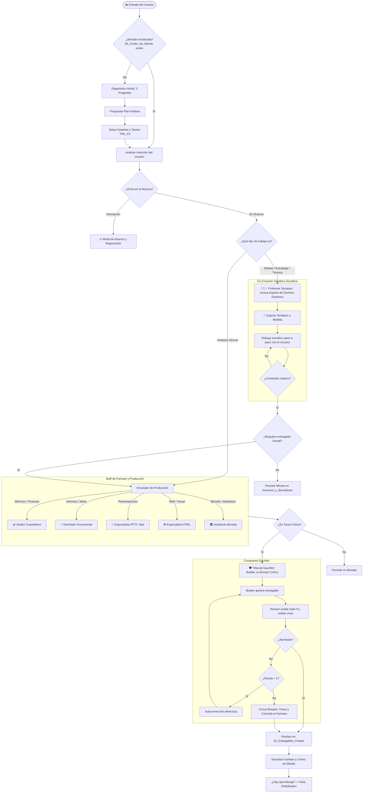

# 🏛️ Cerebro Digital Corporativo: Arquitectura de Arnés con IA, Obsidian y Metodología Ejecutiva

> [!IMPORTANT] AVISO DE AUDITORÍA HUMANA Y ESTÁNDAR DIRECTIVO
> Compendio estratégico destilado para la alta dirección. Diseñado para ejecutivos analíticos no programadores, priorizando la utilidad operativa, la mitigación de alucinaciones y la trazabilidad institucional. Antes de la toma de decisiones críticas de inversión o gestión humana, valide los parámetros de negocio aplicados.
> 
> **Diseñado por:** Ricardo Bonilla · Consultor en Ciencia de Datos  
> **Contacto:** [ribonilla@gmail.com](mailto:ribonilla@gmail.com) · [LinkedIn Perfil](https://www.linkedin.com/in/ricardo-bonilla-jimenez/)

---

## 📌 01. El Reto Ejecutivo
* **El Problema del Chat:** El 80% de las corporaciones interactúan con la IA a través de ventanas de chat efímeras. El resultado es devastador: amnesia operativa entre sesiones, datos inventados sin auditoría y cero trazabilidad para la Junta Directiva.
* **La Solución del Arnés:** El Arnés PARA-Zettelkasten convierte a los modelos en un Chief of Staff permanente que auto-escribe en tu propio disco local, valida números en caliente y construye memoria institucional acumulativa.

---

## 🏛️ 02. Fundamentos: Los 4 Pilares
No se trata de "usar ChatGPT". Es la articulación sinérgica de cuatro tecnologías y métodos:
1. **Obsidian:** La base de operaciones física y privada donde reside el conocimiento en tu propio ordenador.
2. **PARA + Zettelkasten:** La metodología dual que combina orden ejecutivo inmediato con pensamiento compuesto a largo plazo.
3. **Ingeniería de Arnés:** El marco de gobierno y control que dicta qué puede y qué no puede hacer la IA.
4. **Protocolo Gauntlet:** El tribunal de auditoría adversarial que carea los entregables antes de que lleguen a tus manos.

---

## 💎 03. Obsidian: La Bóveda Local Soberana
* **Soberanía y Cero Fuga:** A diferencia de las plataformas SaaS en la nube, Obsidian guarda todo en archivos planos Markdown (`.md`) dentro de tu propio disco. Si se cae internet o la plataforma del proveedor, tus activos siguen intactos.
* **Interconexión Orgánica:** Permite vincular decisiones estratégicas con minutas operativas y entregables finales mediante enlaces bidireccionales, creando un grafo vivo del negocio.

---

## 🧠 04. Metodología PARA-Zettelkasten
* **El Orden Ejecutivo (P.A.R.A. de Tiago Forte):** Estructura orientada a la acción inmediata. Separa lo urgente (*Proyectos* y *Áreas*) de lo recurrente (*Recursos* y *Archivos*), garantizando que encuentres cualquier documento en menos de tres clics.
* **El Conocimiento Compuesto (Zettelkasten de Niklas Luhmann):** Cada duda, corrección o aprendizaje se registra como una nota atómica enlazada. A mayor cantidad de proyectos ejecutados, más inteligente y preciso se vuelve tu arnés institucional.

---

## 🧩 05. Ingeniería de Arnés: Anatomía del Sistema
* **¿Cómo se arma un Agente?**  
  Un agente es un rol directivo con tres directivas: (1) Identidad y perfil de cargo, (2) Reglas innegociables de gobierno, y (3) Caja de herramientas permitidas.
* **¿Cómo se arma una Skill?**  
  Una skill es un procedimiento operativo estándar (SOP) modular. Contiene la guía paso a paso (`SKILL.md`), scripts de soporte y plantillas ejecutivas. Es reutilizable por cualquier agente.
* **¿Qué es un Script Determinista en Python?**  
  Un programa de código duro que realiza cálculos matemáticos, cruces de bases de datos o validación de celdas en caliente sin permitir que el modelo "adivine" cifras.
* **¿Qué es un MCP (Model Context Protocol)?**  
  Una tubería segura y cifrada que permite a los agentes consultar información corporativa externa (SQL, ERPs, CRM) bajo estrictos permisos de lectura y escritura.

---

## 🪜 06. La Cadena de Mando (Quién Llama a Quién)
Trazabilidad jerárquica de invocación desde el mandato de negocio hasta la persistencia física:

```text
[ Nivel 0: SPONSOR HUMANO ]
       │ Emite la directriz de negocio en lenguaje natural
       ▼
[ Nivel 1: COCKPIT CLI ]
       │ Habilita el entorno local seguro y permisos en disco
       ▼
[ Nivel 2: EL ARNÉS (HARNESS RUNTIME) ]
       │ Impone reglas innegociables: auto-escritura, compuerta Gauntlet y trazabilidad
       ▼
[ Nivel 3: AGENTE ORQUESTADOR (PM / CHIEF OF STAFF) ]
       │ Diagnostica (Sponsor, Propósito, Restricciones), crea Kanban y convoca roles
       ▼
[ Nivel 4: AGENTE DE DOMINIO (ESPECIALISTA) ]
       │ Asume el vocabulario y rigor temático (Auditor Cuantitativo, Redactor Minto)
       ▼
[ Nivel 5: SKILL (MANUAL SOP EMPAQUETADO) ]
       │ Carga el manual operativo `SKILL.md` con reglas y plantillas directivas
       ▼
[ Nivel 6: MCPS & SCRIPTS DETERMINISTAS ]
       ├── MCPs: Conectores cifrados a ERP, SQL o archivos de la bóveda
       └── Scripts: Programas en Python que calculan y validan celdas sin "adivinar"
       ▼
[ Nivel 7: BÓVEDA OBSIDIAN (PERSISTENCIA FÍSICA) ]
       Deposita Word limpio (.docx), Markdown gemelo (.md), mueve Kanban y crea Zettelkasten
```

---

## 🔄 07. Flujograma de Ciclo de Vida: El Motor de Decisiones

El arnés discrimina en tiempo real el tipo de trabajo antes de actuar:
1. **Rama de Co-Diseño Estratégico (Professor Synapse):** Si el requerimiento es conceptual, debate o estrategia, convoca un experto temático a medida para sostener un diálogo socrático paso a paso.
2. **Rama de Producción Directa (Staff de Especialistas):** Si el concepto está maduro o es un pedido de formato directo, enruta al Auditor Cuantitativo (.xlsx), Diseñador Documental (.docx), Diseñador PPTX o Especialista HTML.
3. Ambas ramas pasan por el **Tribunal Gauntlet** antes de tocar el disco.



---

## 🛡️ 08. Protocolo Gauntlet (Loop de Calidad & Circuit Breaker)
El arnés nunca te entrega un primer borrador sin someterlo a un careo interno entre dos actores:
1. **The Builder (Constructor):** Genera el informe, modelo o propuesta siguiendo las mejores prácticas.
2. **Revisor Crítico (Auditor Severo):** Aplica la compuerta *Gate 0 de Datos* (cardinalidad, llaves compuestas, relaciones 1:1, 1:N), verifica fórmulas vivas en hojas de cálculo y piso tipográfico de 16pt.
* **Aprobado:** Pasa directo a auto-escritura en disco.
* **Autocorrección (Ronda 2):** El constructor corrige las observaciones del auditor en silencio.
* **Circuit Breaker (Límite 2 rondas):** Si tras dos iteraciones persiste la discrepancia, se detiene la ejecución y se eleva la decisión directamente al sponsor humano.

---

## 🔄 09. Las Seis Estaciones (Experiencia Directiva UX)
Lo que el directivo experimenta en el frente de trabajo:
1. **Estación 1: Diagnóstico Inicial:** 3 preguntas clave (Sponsor/Audiencia, Propósito de Negocio, Restricciones/Plazos).
2. **Estación 2: Plan Concertado:** Aprobación del desglose de tareas antes de mover un solo byte.
3. **Estación 3: Invocación Experta:** Selección y delegación al agente especialista adecuado.
4. **Estación 4: Compuerta Gauntlet:** Careo de calidad y verificación matemática en caliente.
5. **Estación 5: Auto-Escritura Proactiva:** Generación directa en disco del Word limpio y su Markdown gemelo.
6. **Estación 6: Aprendizaje y Zettelkasten:** Registro de cada retroalimentación como lección permanente.

---

## 📂 10. Las 3 Macro-Carpetas (Resguardo en Disco)
* `01_Direccion_y_Estrategia/`: Contiene el mandato del sponsor, los límites de gobernanza y la `Matriz_de_Cambios_y_Acuerdos.md` auditada con fecha y hora (`YYYY-MM-DD HH:MM`).
* `02_Ejecucion_y_Seguimiento/`: Aloja el tablero Kanban nativo, las tareas atómicas `TAR_XX.md` y las minutas cronológicas de sesión.
* `03_Entregables_Finales/`: Almacena los informes Word limpios (`.docx`), sus réplicas Markdown gemelas (`.md`) y el histórico de cambios visuales en rojo dentro de `Historico/`.

---

## ⚡ 11. El Cockpit Maestro (Herramientas & Descargas)
Infraestructura local ligera y sin servidores dedicados:
1. **Starter Kit del Arnés (.zip):** Bóveda lista para descargar y descomprimir ([Descargar Starter Kit](Starter_Kit_Arnes_Universal.zip)).
2. **Obsidian:** Bóveda de conocimiento e interfaz gráfica ([Descargar en obsidian.md](https://obsidian.md/download)).
3. **Python 3.10+:** Motor silencioso de auditoría matemática y manipulación de datos ([Descargar en python.org](https://www.python.org/downloads/)).
4. **Una CLI a Elección:** Consola de mando para operar la IA en lenguaje natural con acceso a tu disco local (**Claude Code** de Anthropic, **Antigravity** de Google, **Codex** de OpenAI, **Pi** u **OpenCode**).

---

## 🚀 12. Cómo Arrancar un Proyecto (Kickoff en 3 Pasos)
1. **Descargar o Copiar el Starter Kit:** Descomprime el archivo `.zip` en tu nuevo directorio de trabajo y ábrelo como bóveda en Obsidian.
2. **Lanzar la CLI:** Abre la terminal en dicha carpeta y ejecuta el comando de tu CLI preferida (ej. `antigravity` o `claude`).
3. **Emitir el Mandato:** Escribe tu objetivo en lenguaje natural (ej. *"Iniciemos el análisis de proveedores del Q4"*). El arnés iniciará el diagnóstico y desplegará el plan de trabajo de inmediato.

---

## 🎁 13. Bono Directivo 1: Arquitectura de tu Propio Arnés
* **Cada Petición es un Loop Completo:** Un arnés no es un proyecto de una sola vez. Cada interacción del usuario es un loop cerrado que arranca, diagnostica, convoca agentes, corre scripts, audita en Gauntlet, persiste el resultado y se reinicia listo para el siguiente requerimiento.
* **Criterio de Arquitectura: ¿Agente o Skill?**
  * Crea un **Agente** cuando requieras un *rol* con autonomía, criterio de negocio, estilo de comunicación y juicio crítico.
  * Crea una **Skill** cuando tengas un *procedimiento* repetible (un manual de pasos, una fórmula o una plantilla) que varios agentes puedan ejecutar. Si las instrucciones de un agente se vuelven puramente metodológicas, extráelas a una Skill.
* **El Músculo Determinista:** Apóyate en Scripts de Python para las tareas donde un error numérico cueste dinero o reputación. La IA orquesta; el script ejecuta el cálculo exacto.

---

## 🎁 14. Bono Directivo 2: Prompt Maestro de Co-Diseño

Copia y pega este prompt maestro directamente en tu CLI (Claude Code, Antigravity o Codex) al abrir tu nueva bóveda:

```markdown
Actúa como un Arquitecto de Sistemas de IA Senior y Chief of Staff empresarial. 
Estoy iniciando la construcción de un ARNÉS DE IA A MEDIDA para mi área corporativa: [ESPECIFICA AQUÍ TU ÁREA: ej. Operaciones / Recursos Humanos / Auditoría Financiera / Cadena de Suministro].

Acabo de desplegar una arquitectura base con metodología PARA (Tiago Forte) y Zettelkasten (Niklas Luhmann) sobre Obsidian, operada a través de una consola CLI con acceso a mi disco local.

Tu objetivo es co-diseñar conmigo el arnés exacto para automatizar, blindar y auditar los flujos de trabajo de mi departamento. Para ello, debes estructurar nuestro sistema bajo estos principios innegociables:

1. FILOSOFÍA DEL LOOP POR PETICIÓN:
Entiende que en este arnés, cada solicitud mía no es un chat efímero, sino un loop cerrado de ejecución y control. Cada petición debe:
- Identificar el requerimiento de negocio exacto.
- Seleccionar y activar al agente especialista adecuado.
- Ejecutar validaciones matemáticas o cruces de datos mediante scripts deterministas en Python (sin alucinaciones numéricas).
- Pasar obligatoriamente por una compuerta adversarial tipo "Gauntlet" (Constructor vs. Auditor Crítico, con un máximo de 2 rondas de corrección antes de elevar discrepancias).
- Auto-escribir el resultado directamente en disco en las 3 macro-carpetas físicas.
- Extraer cualquier duda, corrección o aprendizaje en una nota atómica de Zettelkasten para capitalizar el conocimiento compuesto.

2. DEFINICIÓN DEL STAFF DE AGENTES DE MI ÁREA:
Ayúdame a definir entre 4 y 6 agentes especialistas necesarios para mi operación cotidiana. Para cada agente, define:
- Rol e Identidad ejecutiva.
- Restricciones y límites innegociables (qué NO puede hacer).
- Entregables típicos que produce.

3. CATÁLOGO DE SKILLS MODULARES:
Aplica el principio de desacoplamiento: si una instrucción es un procedimiento repetible, plantilla o estándar técnico, NO debe ir dentro del prompt del agente, sino empaquetada como una "Skill" (carpeta con SKILL.md, plantillas y scripts en Python). Propón las 3 skills prioritarias que mi área requiere.

4. CONECTIVIDAD DETERMINISTA (MCPS Y SCRIPTS):
Identifica qué fuentes de datos corporativas externas requerirán un conector MCP seguro (ej. ERP SAP, base SQL, Salesforce, API de logística) y qué validaciones críticas deben delegarse a scripts de Python con Gate 0 de datos (cardinalidad, llaves primarias, consistencia contable).

5. RESGUARDO EN LAS 3 MACRO-CARPETAS:
Todo el sistema debe persistir en las 3 macro-carpetas físicas:
- 01_Direccion_y_Estrategia/ (Mandatos, límites y Matriz de Decisiones con fecha y hora YYYY-MM-DD HH:MM).
- 02_Ejecucion_y_Seguimiento/ (Tablero Kanban, tareas TAR_XX y minutas de sesión).
- 03_Entregables_Finales/ (Informes limpios en Word, réplicas gemelas en Markdown y versiones históricas con diffs).

PARA EMPEZAR AHORA MISMO:
Hazme las 3 preguntas clave del Diagnóstico Inicial (Sponsor/Audiencia, Propósito de Negocio Principal y Restricciones/Plazos) adaptadas a mi departamento, y presenta tu propuesta preliminar del staff de agentes para mi aprobación.
```

---

*Diseñado por **Ricardo Bonilla** · Consultor en Ciencia de Datos · [ribonilla@gmail.com](mailto:ribonilla@gmail.com) · [LinkedIn](https://www.linkedin.com/in/ricardo-bonilla-jimenez/)*  
*Documento gemelo bimodal sincronizado con el artefacto visual interactivo en [[03_Entregables_Finales/Curso_Wiki_Ejecutivo_Arnes_IA.html]]*
