# 🔄 Flujograma de Ciclo de Vida: El Motor de Decisiones del Arnés

> [!IMPORTANT] AVISO DE AUDITORÍA HUMANA Y ESTÁNDAR DIRECTIVO
> Este diagrama representa la lógica interna mediante la cual el sistema atiende cada requerimiento de negocio. A diferencia de un chat tradicional, el arnés evalúa la madurez de la solicitud, discrimina entre co-creación estratégica y producción de entregables, y activa compuertas de calidad antes de escribir en disco.

---

## 🗺️ 1. Diagrama de Flujo Completo (Mermaid)

```mermaid
flowchart TD
    Start([📥 Entrada del Usuario]) --> InitCheck{¿Bóveda inicializada?<br/>00_Centro_de_Mando existe}
    
    %% FASE INICIAL: DIAGNÓSTICO
    InitCheck -- No / Comando /iniciar --> Phase1[Fase 1: Diagnóstico de Inicio<br/>3 Preguntas: Sponsor, Propósito, Restricciones]
    Phase1 --> Phase2[Fase 2: Propuesta de Fases y Tareas]
    Phase2 --> Phase2Wait[/¿Concertamos este plan?/]
    Phase2Wait --> ApprovePlan{¿Usuario aprueba?}
    ApprovePlan -- Ajustes --> Phase2
    ApprovePlan -- Sí --> SetupVault[Fase 3: Setup Inicial Bóveda<br/>Crear Tareas TAR_XX, Tablero_Kanban.base y Centro_de_Mando]
    SetupVault --> NextTask[Seleccionar Tarea Inmediata ⏳ En Progreso]

    %% CICLO CONTINUO DE INTERACCIÓN
    InitCheck -- Sí --> ReqCheck[Analizar Intención del Usuario]
    NextTask --> ReqCheck
    
    ReqCheck --> ScopeCheck{¿El requerimiento entra en el alcance<br/>y restricciones del proyecto?}
    ScopeCheck -- Desviación de Alcance --> ScopeAlert[⚠️ Alerta de Alcance y Registro en Matriz]
    ScopeAlert --> ConsultUser[/Consultar si ajustamos alcance o descartamos/]
    
    ScopeCheck -- En Alcance --> TypeCheck{¿Qué tipo de trabajo es?}

    %% CAMINO TEMÁTICO: PROFESSOR SYNAPSE
    TypeCheck -- "Co-diseño / Debate / Técnica de Negocio" --> SynapseSummon[🧙🏾‍♂️ Professor Synapse: Invocar Experto de Dominio Dinámico]
    subgraph SynapseCoCreation [Co-creación Temática Socrática]
        SynapseSummon --> DynamicExpert[🧠 Experto Temático Invocado a Medida]
        DynamicExpert --> CoDesignStep[Diálogo socrático paso a paso con el Usuario]
        CoDesignStep --> ValidateContent{¿Contenido técnico maduro?}
        ValidateContent -- No --> CoDesignStep
    end
    ValidateContent -- Sí --> NeedsArtifact{¿Requiere artefacto formal o entregable?}
    NeedsArtifact -- "No (Solo diseño / acuerdo)" --> PersistSession[Persistir Minuta en 02_Ejecucion_y_Seguimiento/Sesiones_y_Borradores]

    %% CAMINO DE PRODUCCIÓN: ESPECIALISTAS DE FORMATO
    TypeCheck -- "Artefacto directo" --> Routing[Enrutamiento a Especialista de Artefacto]
    NeedsArtifact -- "Sí (Requiere entrega)" --> Routing

    subgraph StaffArtefactos [Especialistas de Formato y Producción]
        Routing -->|Finanzas / Métricas| E_Fin[📊 Auditor Cuantitativo]
        Routing -->|Documentos / Minto| E_Doc[📄 Diseñador Documental]
        Routing -->|Presentaciones| E_Vis[🎨 Especialista PPTX 16pt]
        Routing -->|Web / Storytelling| E_Web[🌐 Especialista HTML]
        Routing -->|Estructura / Enlaces| E_Arq[🏛️ Arquitecto Bóveda]
    end

    E_Fin --> CritFilter{¿Es Tarea Crítica?<br/>Entregable final, finanzas, alta dirección}
    E_Doc --> CritFilter
    E_Vis --> CritFilter
    E_Web --> CritFilter
    E_Arq --> CritFilter

    %% CAMINO ESTÁNDAR
    CritFilter -- No (Tarea rutinaria/borrador) --> ExecStd[Ejecución Estándar]
    ExecStd --> PersistStd[Persistir en Bóveda]

    %% PROTOCOLO GAUNTLET LOOP
    CritFilter -- Sí (Crítica) --> Gauntlet[🛡️ Disparo de Protocolo Gauntlet en 4 Bloques]
    
    subgraph GauntletLoop [Compuerta de Calidad: Gauntlet Loop con Auditoría Activa]
        Gauntlet --> BuilderStep[The Builder: Generar Artefacto según Estándar]
        BuilderStep --> CriticStep[Revisor Adversarial: Auditoría Activa en Caliente<br/>Evaluar celdas .xlsx / fuentes .pptx / HTML]
        CriticStep --> BenchCheck{¿Cumple el Listón?<br/>Cero discrepancias numéricas y diseño directivo}
        BenchCheck -- Aprobado --> PassGauntlet[Veredicto: APROBADO]
        BenchCheck -- Rechazado --> IterCheck{¿Iteraciones < 2?}
        IterCheck -- Sí --> FixStep[Reporte de Defectos -> Subsanar en caliente]
        FixStep --> BuilderStep
        IterCheck -- "No (Circuit Breaker)" --> Escalation[Circuit Breaker: Escalar discrepancias al Usuario]
    end

    Escalation --> UserResolve[/Decisión del Usuario/]
    UserResolve --> PassGauntlet

    %% FASE DE CIERRE Y PERSISTENCIA FÍSICA
    PassGauntlet --> PersistCritical[Persistir en 03_Entregables_Finales y registrar en 01_Direccion/Decisiones]
    PersistStd --> UpdateKanban[Actualizar Estado en Kanban y 00_Centro_de_Mando]
    PersistSession --> UpdateKanban
    PersistCritical --> UpdateKanban

    UpdateKanban --> LearnCheck{¿Hay lección, regla o patrón reutilizable?}
    LearnCheck -- Sí --> SaveZettelkasten[Crear Nota Atómica en 01_Direccion/Aprendizajes_y_Conocimiento]
    LearnCheck -- No --> TurnClose[Sintetizar resultado y esperar siguiente turno]
    SaveZettelkasten --> TurnClose
```

---

## 📋 2. Explicación Ejecutiva de las 4 Ramas Principales

### A. Diagnóstico de Inicio y Control de Alcance
Si la bóveda está vacía, el sistema detiene cualquier ejecución técnica y lanza el **Diagnóstico Inicial** (Sponsor, Propósito y Restricciones duras). Una vez acordado el plan, toda petición futura pasa por el filtro de **ScopeCheck**: si el usuario pide algo fuera de los límites acordados, el sistema levanta una bandera de advertencia para evitar sobrecostos o pérdida de foco.

### B. La Rama Socrática: Professor Synapse
Cuando el requerimiento es conceptual, estratégico o de análisis de negocio, no se redacta un informe de inmediato. **Professor Synapse** invoca dinámicamente al experto de dominio requerido (ej. Especialista en Cadena de Suministro Farmacéutica o Auditor Forense) para sostener un diálogo socrático paso a paso hasta madurar la propuesta.

### C. La Rama de Producción: Staff Especializado
Cuando la idea madura y requiere un entregable formal, la batuta pasa a los agentes de producción según el formato:
* **Auditor Cuantitativo:** Modela en Excel con fórmulas vivas y scripts de validación en Python.
* **Diseñador Documental:** Redacta memorandos bajo el Principio de Pirámide de Minto en Word (.docx) y Markdown (.md).
* **Especialista PPTX:** Diseña presentaciones con notas de oratoria y piso tipográfico de 16pt.
* **Especialista HTML:** Estructura experiencias interactivas y scrollytelling en tema claro.
* **Arquitecto de Bóveda:** Enlaza notas atómicas y mantiene sincronizado el tablero Kanban.

### D. La Compuerta Gauntlet y el Circuit Breaker
Para entregables críticos de alta dirección, se activa el careo interno entre **The Builder** y el **Revisor Crítico**. Si el borrador tiene fórmulas rotas o datos desalineados, el constructor corrige en caliente (máximo 2 rondas). Si la discrepancia es insalvable, el **Circuit Breaker** frena la publicación y eleva la evidencia exacta al director humano.

---

*Diseñado por **Ricardo Bonilla** · Consultor en Ciencia de Datos · [ribonilla@gmail.com](mailto:ribonilla@gmail.com) · [LinkedIn](https://www.linkedin.com/in/ricardo-bonilla-jimenez/)*
