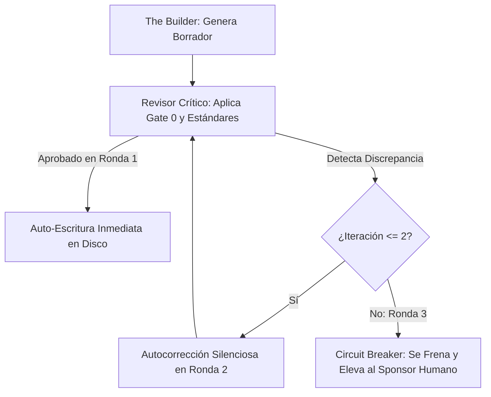

# 🏛️ Cerebro Digital Corporativo: Arnés de Decisiones y Entregables con IA

> **Bóveda Operativa Inteligente basada en Obsidian, Metodología P.A.R.A. y Zettelkasten**  
> Diseñada para comités directivos, líderes de operaciones, consultores y analistas que requieren gobernar la IA con rigor empresarial, trazabilidad innegociable y cero alucinaciones.

[](https://cerebro-digital-arnes.netlify.app/)
[](LICENSE)
[](https://obsidian.md/)
[](#-protocolo-gauntlet-auditoría-adversarial-activa)

---

## 🌐 1. Curso Interactivo y Wiki Ejecutiva en Vivo

Accede a la experiencia interactiva en formato diapositiva editorial inspirada en consultoría de élite:  
👉 **[https://cerebro-digital-arnes.netlify.app/](https://cerebro-digital-arnes.netlify.app/)**

Incluye:
* Navegación en 13 diapositivas interactivas en tema claro editorial.
* Inspector táctil de la **Anatomía del Arnés** con pin deslizador y scroll horizontal asistido.
* Organigrama de la **Cadena de Mando (L0 a L7)** con explicación de quién llama a quién.
* Simulador interactivo de los tres escenarios del **Tribunal Gauntlet**.
* Botón de copiado en 1 clic del **Prompt Maestro de Co-Diseño**.
* Modo de impresión profesional a PDF apaisado (`Ctrl + P` o botón directo).

---

## 📌 2. El Reto Ejecutivo: ¿Por qué un Arnés?

El 80% de las corporaciones interactúan con la IA como si fuera un simple chat de mensajería efímera:
* **Amnesia Operativa:** Cada sesión inicia desde cero; no hay memoria de acuerdos pasados.
* **Alucinaciones Silenciosas:** Modelos que inventan cifras, pegan números estáticos en Excel o aprueban supuestos sin contrastar.
* **Cero Trazabilidad:** Nadie puede auditar para una Junta Directiva quién tomó una decisión, qué parámetros se aplicaron o por qué cambió una cifra.

**El Arnés PARA-Zettelkasten** transforma cualquier modelo de lenguaje de frontera (Claude, Gemini, GPT-4o, DeepSeek) en un **Chief of Staff & Sparring Partner** que reside en tu disco duro local, auto-escribe informes limpios, ejecuta validaciones matemáticas en caliente y acumula memoria corporativa permanente.

---

## 🏛️ 3. Los 4 Pilares del Sistema

```text
┌────────────────────────────────────────────────────────────────────────┐
│                   LOS CUATRO PILARES DEL CEREBRO DIGITAL               │
├───────────────────────────────┬────────────────────────────────────────┤
│ 💎 OBSIDIAN                   │ 🧠 PARA + ZETTELKASTEN                 │
│ Bóveda local soberana. Texto  │ Organización de acción rápida (Forte)  │
│ plano Markdown sin fuga a SaaS│ + conocimiento compuesto vivo (Luhmann)│
├───────────────────────────────┼────────────────────────────────────────┤
│ ⚙️ INGENIERÍA DE ARNÉS        │ 🛡️ PROTOCOLO GAUNTLET                  │
│ Reglas de gobierno, agentes   │ Tribunal adversarial interno que carea │
│ de dominio, skills y scripts. │ el entregable antes de que lo leas.    │
└───────────────────────────────┴────────────────────────────────────────┘
```

1. **Obsidian:** Tu base física local. Todo se guarda en archivos Markdown estándar (`.md`). Si un proveedor de IA cambia sus términos o se corta internet, tu conocimiento corporativo sigue 100% intacto en tu equipo.
2. **Método Dual (PARA + Zettelkasten):** Estructura orientada a la acción ejecutiva inmediata (encontrar cualquier documento en menos de tres clics) fusionada con enlaces bidireccionales que interconectan decisiones con minutas y entregables.
3. **Ingeniería de Arnés:** Marco metodológico estricto que impone reglas duras: prohibición de complacencia, auto-escritura obligatoria y separación de roles.
4. **Protocolo Gauntlet:** Compuerta de calidad activa donde un *Revisor Crítico* examina sin piedad el borrador de *The Builder* antes de que el usuario lo vea.

---

## 📂 4. Estructura Física: La Regla de las 3 Macro-Carpetas

La bóveda está organizada en tres macro-carpetas físicas limpias para eliminar la fricción mental:

```text
📁 BÓVEDA DEL PROYECTO
 │
 ├── 🎯 00_Centro_de_Mando.md              <-- Tablero de brújula y acceso directo en 1 clic
 ├── 🧭 GUIA_ESTRUCTURA_BOVEDA.md          <-- Manual de navegación para nuevos usuarios
 │
 ├── 📁 01_Direccion_y_Estrategia/         <-- ¿Por qué lo hacemos y bajo qué reglas?
 │    ├── Alcance_y_Objetivos/             <-- Mandato del sponsor, objetivos y límites negativos
 │    ├── Decisiones_y_Acuerdos/           <-- Matriz_de_Cambios_y_Acuerdos.md con fecha y hora
 │    └── Aprendizajes_y_Conocimiento/     <-- Notas Zettelkasten y biblioteca de Prompts/
 │
 ├── 📁 02_Ejecucion_y_Seguimiento/        <-- ¿En qué estamos trabajando hoy?
 │    ├── Kanban_y_Tareas/                 <-- Tablero_Kanban.base nativo y tareas TAR_XX.md
 │    └── Sesiones_y_Borradores/           <-- Minutas cronológicas (Sesion_YYYY-MM-DD_HHmm_Tema)
 │
 └── 📁 03_Entregables_Finales/            <-- ¿Qué entregamos limpio a la Junta?
      ├── (Raíz)                           <-- Informes Word (.docx), réplicas .md y Excel limpios
      └── Historico/                       <-- Versiones pasadas con diffs visuales en rojo
```

---

## 🪜 5. Cadena de Mando: ¿Quién Llama a Quién?

El arnés opera bajo un árbol de ejecución jerárquico que desciende desde la directriz humana hasta la persistencia física:

```text
[ Nivel 0: SPONSOR HUMANO ]
       │ Emite el mandato en lenguaje natural
       ▼
[ Nivel 1: COCKPIT CLI ]
       │ Consola segura (Claude Code, Antigravity, Codex) con permisos locales
       ▼
[ Nivel 2: EL ARNÉS (HARNESS RUNTIME) ]
       │ Impone reglas innegociables: auto-escritura, trazabilidad y compuerta Gauntlet
       ▼
[ Nivel 3: AGENTE ORQUESTADOR (CHIEF OF STAFF / PM) ]
       │ Diagnostica el propósito, crea el Kanban y convoca a los roles
       ▼
[ Nivel 4: AGENTE ESPECIALISTA DE DOMINIO ]
       │ Asume el vocabulario y criterio temático (Auditor Financiero, Redactor Minto)
       ▼
[ Nivel 5: SKILL (PROCEDIMIENTO SOP EMPAQUETADO) ]
       │ Carga el manual operativo `SKILL.md`, plantillas y scripts de soporte
       ▼
[ Nivel 6: MCPS & SCRIPTS DETERMINISTAS ]
       ├── MCPs: Tuberías cifradas hacia ERP, bases SQL o CRM corporativo
       └── Scripts: Programas en Python que calculan fórmulas y cruzan tablas sin estimar
       ▼
[ Nivel 7: BÓVEDA OBSIDIAN (PERSISTENCIA FÍSICA) ]
       Auto-escribe el Word (.docx), la réplica Markdown (.md) y mueve el Kanban
```

### Anatomía Interna:
* **¿Qué es un Agente?** Un perfil de cargo directivo con autonomía, criterio de negocio y reglas innegociables.
* **¿Qué es una Skill?** Un manual de procedimientos estándar (SOP) modular y reutilizable. Si una instrucción para un agente es puramente metodológica, se extrae a una Skill.
* **¿Qué es un Script Determinista?** Código puro en Python para tareas donde un error numérico cuesta dinero o reputación.
* **¿Qué es un MCP (Model Context Protocol)?** Un conector seguro para que la IA consulte bases de datos corporativas sin exponer credenciales.

---

## 🔄 6. Flujograma Completo del Ciclo de Vida: El Motor de Decisiones

A diferencia de un chat simple, el arnés evalúa la madurez de cada requerimiento, discrimina entre **co-diseño conceptual socrático (Professor Synapse)** y **producción de entregables (Staff Especialista)**, y somete todo entregable a la compuerta **Gauntlet**:

```mermaid
flowchart TD
    Start([📥 Entrada del Usuario]) --> InitCheck{¿Bóveda inicializada?<br/>00_Centro_de_Mando existe}
    
    %% FASE INICIAL: DIAGNÓSTICO
    InitCheck -- No / Comando /iniciar --> Phase1[Fase 1: Diagnóstico de Inicio<br/>3 Preguntas: Sponsor, Propósito, Restricciones]
    Phase1 --> Phase2[Fase 2: Propuesta de Fases y Tareas]
    Phase2 --> Phase2Wait[/¿Concertamos este plan?/]
    Phase2Wait --> ApprovePlan{¿Usuario aprueba?}
    ApprovePlan -- Ajustes --> Phase2
    ApprovePlan -- Sí --> SetupVault[Fase 3: Setup Inicial Bóveda<br/>Crear Tareas TAR_XX, Tablero_Kanban.base y Centro_de_Mando]
    SetupVault --> NextTask[Seleccionar Tarea Inmediata ⏳ En Progreso]

    %% CICLO CONTINUO DE INTERACCIÓN
    InitCheck -- Sí --> ReqCheck[Analizar Intención del Usuario]
    NextTask --> ReqCheck
    
    ReqCheck --> ScopeCheck{¿El requerimiento entra en el alcance<br/>y restricciones del proyecto?}
    ScopeCheck -- Desviación de Alcance --> ScopeAlert[⚠️ Alerta de Alcance y Registro en Matriz]
    ScopeAlert --> ConsultUser[/Consultar si ajustamos alcance o descartamos/]
    
    ScopeCheck -- En Alcance --> TypeCheck{¿Qué tipo de trabajo es?}

    %% CAMINO TEMÁTICO: PROFESSOR SYNAPSE
    TypeCheck -- "Co-diseño / Debate / Estrategia" --> SynapseSummon[🧙🏾‍♂️ Professor Synapse: Invocar Experto de Dominio Dinámico]
    subgraph SynapseCoCreation [Co-creación Temática Socrática]
        SynapseSummon --> DynamicExpert[🧠 Experto Temático Invocado a Medida]
        DynamicExpert --> CoDesignStep[Diálogo socrático paso a paso con el Usuario]
        CoDesignStep --> ValidateContent{¿Contenido técnico maduro?}
        ValidateContent -- No --> CoDesignStep
    end
    ValidateContent -- Sí --> NeedsArtifact{¿Requiere artefacto formal o entregable?}
    NeedsArtifact -- "No (Solo diseño / acuerdo)" --> PersistSession[Persistir Minuta en 02_Ejecucion_y_Seguimiento/Sesiones_y_Borradores]

    %% CAMINO DE PRODUCCIÓN: ESPECIALISTAS DE FORMATO
    TypeCheck -- "Artefacto directo" --> Routing[Enrutamiento a Especialista de Artefacto]
    NeedsArtifact -- "Sí (Requiere entrega)" --> Routing

    subgraph StaffArtefactos [Especialistas de Formato y Producción]
        Routing -->|Finanzas / Métricas| E_Fin[📊 Auditor Cuantitativo]
        Routing -->|Documentos / Minto| E_Doc[📄 Diseñador Documental]
        Routing -->|Presentaciones| E_Vis[🎨 Especialista PPTX 16pt]
        Routing -->|Web / Storytelling| E_Web[🌐 Especialista HTML]
        Routing -->|Estructura / Enlaces| E_Arq[🏛️ Arquitecto Bóveda]
    end

    E_Fin --> CritFilter{¿Es Tarea Crítica?<br/>Entregable final, finanzas, alta dirección}
    E_Doc --> CritFilter
    E_Vis --> CritFilter
    E_Web --> CritFilter
    E_Arq --> CritFilter

    %% CAMINO ESTÁNDAR
    CritFilter -- No (Tarea rutinaria/borrador) --> ExecStd[Ejecución Estándar]
    ExecStd --> PersistStd[Persistir en Bóveda]

    %% PROTOCOLO GAUNTLET LOOP
    CritFilter -- Sí (Crítica) --> Gauntlet[🛡️ Disparo de Protocolo Gauntlet en 4 Bloques]
    
    subgraph GauntletLoop [Compuerta de Calidad: Gauntlet Loop con Auditoría Activa]
        Gauntlet --> BuilderStep[The Builder: Generar Artefacto según Estándar]
        BuilderStep --> CriticStep[Revisor Adversarial: Auditoría Activa en Caliente<br/>Evaluar celdas .xlsx / fuentes .pptx / HTML]
        CriticStep --> BenchCheck{¿Cumple el Listón?<br/>Cero discrepancias numéricas y diseño directivo}
        BenchCheck -- Aprobado --> PassGauntlet[Veredicto: APROBADO]
        BenchCheck -- Rechazado --> IterCheck{"¿Iteraciones menor a 2?"}
        IterCheck -- Sí --> FixStep["Reporte de Defectos: Subsanar en caliente"]
        FixStep --> BuilderStep
        IterCheck -- "No (Circuit Breaker)" --> Escalation[Circuit Breaker: Escalar discrepancias al Usuario]
    end

    Escalation --> UserResolve[/Decisión del Usuario/]
    UserResolve --> PassGauntlet

    %% FASE DE CIERRE Y PERSISTENCIA FÍSICA
    PassGauntlet --> PersistCritical[Persistir en 03_Entregables_Finales y registrar en 01_Direccion/Decisiones]
    PersistStd --> UpdateKanban[Actualizar Estado en Kanban y 00_Centro_de_Mando]
    PersistSession --> UpdateKanban
    PersistCritical --> UpdateKanban

    UpdateKanban --> LearnCheck{¿Hay lección, regla o patrón reutilizable?}
    LearnCheck -- Sí --> SaveZettelkasten[Crear Nota Atómica en 01_Direccion/Aprendizajes_y_Conocimiento]
    LearnCheck -- No --> TurnClose[Sintetizar resultado y esperar siguiente turno]
    SaveZettelkasten --> TurnClose
```



### 🏛️ La Pregunta Clave: ¿Dónde está codificado este flujo para que el agente lo siga mecánicamente?

El agente **no "mira" el dibujo de Mermaid** para actuar en tiempo real. El diagrama visual es el plano de ingeniería que representa un sistema de reglas duras distribuidas en tres niveles de la arquitectura:

1. **La Fontanería Real y el Código de Construcción (`AGENTS.md`, `GEMINI.md`, `CLAUDE.md` y `.harness/REGLAS_OPERATIVAS_IA.md`):**  
   Son las **System Instructions** que cualquier CLI (Claude Code, Antigravity, Codex) inyecta de forma obligatoria en la memoria de trabajo de la IA en cada sesión. Allí están codificadas en directivas ejecutables:
   * **Regla #0:** Auto-bootstrap y las 3 preguntas de diagnóstico inicial.
   * **Regla #1:** Auto-escritura proactiva obligatoria en las 3 macro-carpetas físicas.
   * **Regla #2:** Flujo de interacción de **Professor Synapse** (la plantilla de diálogo socrático paso a paso).
   * **Regla #4:** El protocolo **Gauntlet Loop** (The Builder vs. Revisor Crítico, Gate 0 de datos y el Circuit Breaker de 2 rondas).
2. **El Organigrama del Staff (`.harness/Agentes/EXPERTOS_Y_ROLES.md`):**  
   Define los perfiles de cargo exactos: el Orquestador PM, Professor Synapse (*Summoner* dinámico) y los 5 especialistas de formato (Auditor Cuantitativo, Diseñador Documental, PPTX, HTML y Arquitecto Bóveda).
3. **El Tablero de Control para el Humano (`00_Centro_de_Mando.md`):**  
   Este archivo **NO contiene las órdenes del agente**, sino la interfaz de usuario en Obsidian: el tablero de llaves de paso, switches e indicadores para que el director opere la casa en un clic sin tener que meterse en las cañerías de `.harness/`.

> 💡 **La analogía arquitectónica:**
> * **El diagrama Mermaid:** Es el **plano arquitectónico** que vemos humanos y directivos para entender de un vistazo cómo fluye el agua y la electricidad en el edificio.
> * **`AGENTS.md` y `.harness/REGLAS_OPERATIVAS_IA.md`:** Es el **código de construcción y la fontanería real** que la IA lee para saber qué hacer en cada bifurcación.
> * **`00_Centro_de_Mando.md`:** Es el **tablero de llaves y fusibles en la pared** para que el dueño opere la casa sin ensuciarse en las tuberías.

---

## 🛡️ 7. Protocolo Gauntlet: Auditoría Adversarial Activa

Ningún entregable se publica en el primer borrador. El arnés activa un careo interno entre dos actores:

1. **The Builder (Constructor):** Genera el informe, el modelo financiero o la presentación.
2. **Revisor Crítico (Auditor Severo):** Aplica la compuerta **Gate 0 de Datos** (cardinalidad, llaves compuestas, relaciones 1:1, 1:N), audita fórmulas vivas en Excel y exige un piso tipográfico de 16pt en diapositivas.



* **Circuit Breaker:** Si tras dos rondas persiste una discrepancia metodológica o financiera, el arnés **detiene la publicación** y eleva el conflicto al sponsor humano con evidencia exacta, impidiendo bucles infinitos y costos desmedidos de tokens.

---

## 🔄 8. Las Seis Estaciones (Experiencia Directiva UX)

Lo que el directivo experimenta en el frente de trabajo:

1. **Estación 1: Diagnóstico Inicial:** 3 preguntas de alineación (Sponsor/Audiencia, Propósito de Negocio y Restricciones duras).
2. **Estación 2: Plan Concertado:** Aprobación del desglose de fases y tareas en el Kanban antes de ejecutar.
3. **Estación 3: Invocación Experta:** Delegación en el especialista temático adecuado.
4. **Estación 4: Compuerta Gauntlet:** Careo de calidad y auditoría de celdas vivas en caliente.
5. **Estación 5: Auto-Escritura Proactiva:** Generación directa en disco del Word final limpio y su réplica Markdown gemela.
6. **Estación 6: Aprendizaje y Zettelkasten:** Captura de cada retroalimentación o duda como una lección permanente en el banco de conocimiento.

---

## ⚡ 9. El Cockpit Maestro & Inicio Rápido (Kickoff en 3 Pasos)

No se requieren servidores corporativos ni configuraciones complejas. Solo necesitas tres piezas ligeras:

1. **Obsidian:** Interfaz gráfica para explorar tu bóveda ([Descargar en obsidian.md](https://obsidian.md/download)).
2. **Python 3.10+:** Motor silencioso de cálculo y validación de datos ([Descargar en python.org](https://www.python.org/downloads/)).
3. **Una CLI a Elección:** Consola para interactuar en lenguaje natural con permisos en tu disco (**Claude Code**, **Antigravity**, **Codex**, **Pi** u **OpenCode**).

### Rutina de Arranque:
```bash
# 1. Clona este repositorio o descarga el Starter Kit
git clone https://github.com/ribonilla/arnesOrquestador.git Mi_Nuevo_Proyecto
cd Mi_Nuevo_Proyecto

# 2. Lanza tu CLI preferida desde la carpeta del proyecto
antigravity
# o también: claude / codex

# 3. Emite tu mandato de negocio en lenguaje natural
# Ej: "Iniciemos la auditoría de costos logísticos del Q4"
```

---

## 🎁 10. Bono Directivo: Prompt Maestro para Co-Diseñar tu Arnés

¿Deseas armar un arnés a la medida exacta de tu departamento (Operaciones, RRHH, Finanzas, Legal)?

Abre tu CLI en una bóveda nueva y pega el siguiente prompt arquitectónico:

```markdown
Actúa como un Arquitecto de Sistemas de IA Senior y Chief of Staff empresarial. 
Estoy iniciando la construcción de un ARNÉS DE IA A MEDIDA para mi área corporativa: [ESPECIFICA AQUÍ TU ÁREA: ej. Operaciones / Recursos Humanos / Auditoría Financiera / Cadena de Suministro].

Acabo de desplegar una arquitectura base con metodología PARA (Tiago Forte) y Zettelkasten (Niklas Luhmann) sobre Obsidian, operada a través de una consola CLI con acceso a mi disco local.

Tu objetivo es co-diseñar conmigo el arnés exacto para automatizar, blindar y auditar los flujos de trabajo de mi departamento. Para ello, debes estructurar nuestro sistema bajo estos principios innegociables:

1. FILOSOFÍA DEL LOOP POR PETICIÓN:
Entiende que en este arnés, cada solicitud mía no es un chat efímero, sino un loop cerrado de ejecución y control. Cada petición debe:
- Identificar el requerimiento de negocio exacto.
- Seleccionar y activar al agente especialista adecuado.
- Ejecutar validaciones matemáticas o cruces de datos mediante scripts deterministas en Python (sin alucinaciones numéricas).
- Pasar obligatoriamente por una compuerta adversarial tipo "Gauntlet" (Constructor vs. Auditor Crítico, con un máximo de 2 rondas de corrección antes de elevar discrepancias).
- Auto-escribir el resultado directamente en disco en las 3 macro-carpetas físicas.
- Extraer cualquier duda, corrección o aprendizaje en una nota atómica de Zettelkasten para capitalizar el conocimiento compuesto.

2. DEFINICIÓN DEL STAFF DE AGENTES DE MI ÁREA:
Ayúdame a definir entre 4 y 6 agentes especialistas necesarios para mi operación cotidiana. Para cada agente, define:
- Rol e Identidad ejecutiva.
- Restricciones y límites innegociables (qué NO puede hacer).
- Entregables típicos que produce.

3. CATÁLOGO DE SKILLS MODULARES:
Aplica el principio de desacoplamiento: si una instrucción es un procedimiento repetible, plantilla o estándar técnico, NO debe ir dentro del prompt del agente, sino empaquetada como una "Skill" (carpeta con SKILL.md, plantillas y scripts en Python). Propón las 3 skills prioritarias que mi área requiere.

4. CONECTIVIDAD DETERMINISTA (MCPS Y SCRIPTS):
Identifica qué fuentes de datos corporativas externas requerirán un conector MCP seguro (ej. ERP SAP, base SQL, Salesforce, API de logística) y qué validaciones críticas deben delegarse a scripts de Python con Gate 0 de datos (cardinalidad, llaves primarias, consistencia contable).

5. RESGUARDO EN LAS 3 MACRO-CARPETAS:
Todo el sistema debe persistir en las 3 macro-carpetas físicas:
- 01_Direccion_y_Estrategia/ (Mandatos, límites y Matriz de Decisiones con fecha y hora YYYY-MM-DD HH:MM).
- 02_Ejecucion_y_Seguimiento/ (Tablero Kanban, tareas TAR_XX y minutas de sesión).
- 03_Entregables_Finales/ (Informes limpios en Word, réplicas gemelas en Markdown y versiones históricas con diffs).

PARA EMPEZAR AHORA MISMO:
Hazme las 3 preguntas clave del Diagnóstico Inicial (Sponsor/Audiencia, Propósito de Negocio Principal y Restricciones/Plazos) adaptadas a mi departamento, y presenta tu propuesta preliminar del staff de agentes para mi aprobación.
```

---

## 👤 11. Autor y Contacto

Diseñado y desarrollado por:

* **Ricardo Bonilla**  
  *Consultor en Ciencia de Datos, Arquitectura de Información e IA Aplicada*  
  ✉️ **Correo Directo:** [ribonilla@gmail.com](mailto:ribonilla@gmail.com)  
  🔗 **LinkedIn:** [linkedin.com/in/ricardo-bonilla-jimenez](https://www.linkedin.com/in/ricardo-bonilla-jimenez/)  
  🌐 **Sitio Web del Curso:** [cerebro-digital-arnes.netlify.app](https://cerebro-digital-arnes.netlify.app/)

---

## 📄 12. Licencia

Este proyecto está distribuido bajo la licencia MIT. Eres libre de usarlo, adaptarlo e implementarlo en tu organización manteniendo los créditos de autoría originales.
