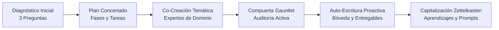

# 🏛️ Arnés de Gestión de Proyectos, Decisiones y Entregables con IA (PARA + Zettelkasten)

> **Bienvenido a tu Bóveda Inteligente:** Un sistema de trabajo colaborativo para Obsidian y asistentes de IA (Gemini, Claude, Antigravity, OpenAI) que conduce proyectos de principio a fin, audita la calidad técnica y preserva la memoria corporativa sin fricción.

---

## 🧭 1. Navegación Rápida de la Bóveda

Para entender de inmediato dónde se guardan tus archivos y no perderte entre carpetas:

```text
📁 BÓVEDA DEL PROYECTO
 │
 ├── 🎯 00_Centro_de_Mando.md        <-- Dashboard general y brújula de acceso en 1 clic
 ├── 🧭 GUIA_ESTRUCTURA_BOVEDA.md    <-- Mapa explicativo de carpetas y preguntas frecuentes
 │
 ├── 📁 01_Direccion_y_Estrategia/   <-- ¿Por qué lo hacemos y bajo qué reglas?
 │    ├── Alcance_y_Objetivos/       <-- Mandato, sponsor y límites innegociables
 │    ├── Decisiones_y_Acuerdos/     <-- Matriz de cambios y acuerdos auditables
 │    └── Aprendizajes_y_Conocimiento/ <-- Lecciones aprendidas y banco de Prompts sugeridos
 │
 ├── 📁 02_Ejecucion_y_Seguimiento/  <-- ¿En qué estamos trabajando hoy?
 │    ├── Kanban_y_Tareas/           <-- Tablero Kanban interactivo (.base) y notas de tareas
 │    └── Sesiones_y_Borradores/     <-- Minutas de ideación y reflexiones con IA
 │
 └── 📁 03_Entregables_Finales/      <-- ¿Qué tengo que entregarle a mi jefe?
      ├── (Raíz)                     <-- Informes Word (.docx), Markdown, Excel, PPTX y HTML limpios
      └── Historico/                 <-- Versiones anteriores con diferencias en rojo
```

---

## 🗺️ 2. ¿Qué está haciendo el Arnés? (Ciclo de Vida y Flujograma)

El arnés no es un simple chat; es un **Orquestador Metodológico** que opera de forma predecible y transparente. 

Puedes consultar en cualquier momento el flujograma detallado en **`[.harness/Agentes/FLUJOGRAMA_ORQUESTADOR.md](file:///.harness/Agentes/FLUJOGRAMA_ORQUESTADOR.md)`** o pedirle al agente: *"Muéstrame el flujograma o dime qué estás haciendo"*.

### Flujo de Interacción:


1. **Fase 1: Diagnóstico de Inicio:** Si el proyecto no está diagnosticado, el agente te hace 3 preguntas clave (Sponsor/Audiencia, Propósito de Negocio y Restricciones duras).
2. **Fase 2: Plan de Fases Concertado:** Te propone las fases y hitos para el Kanban antes de ejecutar.
3. **Fase 3: Co-Creación Temática:** Invoca especialistas a medida para estructurar tus ideas.
4. **Fase 4: Compuerta Gauntlet Loop:** Antes de entregarte un informe crítico, un auditor adversarial revisa fórmulas de Excel, tipografía de diapositivas y reglas de presentación.
5. **Fase 5: Auto-Escritura Proactiva:** El agente persiste automáticamente acuerdos, minutas y entregables finales sin que tengas que pedir *"guarda esto"*.
6. **Fase 6: Aprendizaje Continuo:** Cada duda, descuadre reportado o interacción genera notas atómicas en el banco de conocimiento.

---

## 💡 3. Preguntas Frecuentes

### ¿Dónde encuentro la respuesta que me dio el agente en el chat?
* **Análisis y debates:** En `02_Ejecucion_y_Seguimiento/Sesiones_y_Borradores/`.
* **Acuerdos o cambios de números:** En `01_Direccion_y_Estrategia/Decisiones_y_Acuerdos/Matriz_de_Cambios_y_Acuerdos.md`.
* **Documentos definitivos:** En `03_Entregables_Finales/`.

### ¿Cómo pido mejor las cosas sin conocer la fontanería interna?
Consulta la carpeta **`01_Direccion_y_Estrategia/Aprendizajes_y_Conocimiento/Prompts/`**, donde documentamos patrones de cómo pedir mejor los resultados para que el agente te entregue análisis de máximo valor.
